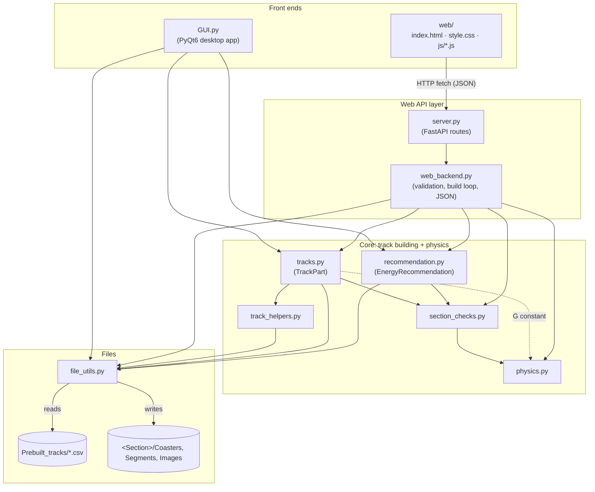
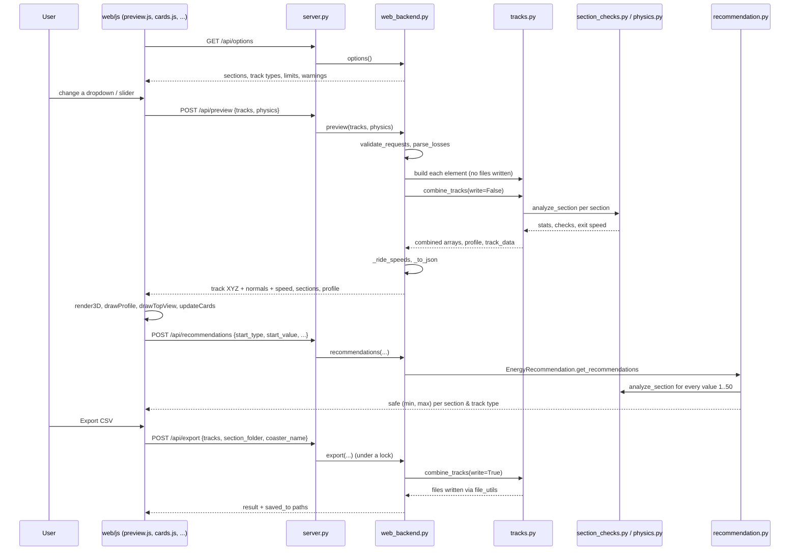

# IMPETUS — Code Documentation

IMPETUS generates roller coaster tracks for **NoLimits 2**. You pick one track element per section
(start, thrills, turns, ends), the program builds each element from equations or prebuilt CSVs,
joins them into one track, runs rider-safety physics checks, and exports a NoLimits 2 spline CSV.

There are **two front ends** sharing the same Python core:

| Front end | Start it with | What it is |
|---|---|---|
| Desktop app | `python GUI.py` | PyQt6 window with matplotlib plots. Also exports SVG print layouts. |
| Web app | `python server.py` (add `--lan` for other devices) | FastAPI server + HTML/JS page with a 3D Three.js view and a ride simulation. |

> The diagrams below use [Mermaid](https://mermaid.js.org/). They render automatically on GitHub.
> In VS Code, install the *Markdown Preview Mermaid Support* extension and open the Markdown preview (`Ctrl+Shift+V`).

---

## File index

| File | Layer | One-line summary | Docs |
|---|---|---|---|
| `GUI.py` | Front end (desktop) | PyQt6 main window: pick tracks, see plots/stats, export | [GUI.md](files/GUI.md) |
| `web/index.html`, `web/style.css`, `web/js/*.js` | Front end (browser) | Web page: section cards, 3D view, ride sim, profile/top view | [web_frontend.md](files/web_frontend.md) |
| `server.py` | Web API | FastAPI app: HTTP routes + serves the `web/` folder | [server.md](files/server.md) |
| `web_backend.py` | Web API | Qt-free build loop: validation, preview, export, recommendations → JSON | [web_backend.md](files/web_backend.md) |
| `recommendation.py` | Core | Finds the safe slider range for each track type | [recommendation.md](files/recommendation.md) |
| `tracks.py` | Core | `TrackPart`: one function per track element + `combine_tracks` | [tracks.md](files/tracks.md) |
| `track_helpers.py` | Core | Vector/normal maths, ramps, saving/loading track parts | [track_helpers.md](files/track_helpers.md) |
| `section_checks.py` | Core | Which physics checks apply to which element, and where | [section_checks.md](files/section_checks.md) |
| `physics.py` | Core | Formulas: speed, friction/air losses, curvature, g-forces, pass/fail checks | [physics.md](files/physics.md) |
| `file_utils.py` | I/O | Folders, CSV read/write, NoLimits 2 format, SVG layout export | [file_utils.md](files/file_utils.md) |
| `Prebuilt_tracks/*.csv`, `requirements.txt` | Data / config | Real-coaster shapes used as templates; Python dependencies | [data_and_config.md](files/data_and_config.md) |

---

## Diagram 1 — How the files depend on each other

Arrows mean "imports / calls". Both front ends funnel into the same core (`tracks.py`), so a fix in the
core applies to both apps.



---

## Diagram 2 — What happens when a track is built

This is the same pipeline for the desktop **Create** button (`GUI.start_generating`) and the web
**preview / export** (`web_backend._build`).

```mermaid
flowchart LR
    A["User picks<br/>(section, type, value)<br/>for each section"] --> B["Validate input<br/>(range 1–50, type allowed in section)"]
    B --> C["Build each element<br/>track_function_map[type](value)<br/>→ tracks.TrackPart.*_func"]
    C --> D["TrackPart.combine_tracks"]
    subgraph D_["inside combine_tracks"]
        D1["start_exit_speed<br/>(speed leaving 'Starts')"] --> D2["for each later section:<br/>section_checks.analyze_section<br/>→ stats, checks, v_exit"]
        D2 --> D3["flip 'Thrills 2' / 'Ends',<br/>shift to join previous piece"]
        D3 --> D4["concatenate +<br/>add_loop_back to station"]
        D4 --> D5["calculate_xy_composition<br/>(side profile)"]
    end
    D --> D1
    D5 --> E{"write?"}
    E -- "yes (export / GUI)" --> F["file_utils.csv_noLimits_format<br/>&lt;Section&gt;/Coasters/&lt;name&gt;_0.csv"]
    E -- "no (web preview)" --> G["return arrays only"]
    F --> H["Show results"]
    G --> H
    H --> H1["GUI: matplotlib plots,<br/>stats dialogs, SVG export"]
    H --> H2["Web: JSON → 3D view,<br/>ride sim, warnings"]
```



---

## Diagram 3 — Web request sequence (live preview)



---

## Key concepts used everywhere

### Sections and track types
A coaster is up to five sections, always in this order. `Starts` is required; the others are optional.

| Section | Allowed types | Slider value means |
|---|---|---|
| Starts | Launcher, Lift Hill, Rollback | Launcher: length (m). Others: height (m) |
| Thrills 1 | Loop, Camelback, Corkscrew | height (m) |
| Turns | Cobra Roll, Horseshoe, Helix | height (m) |
| Thrills 2 | Loop, Camelback, Corkscrew | height (m) |
| Ends | Brake, Rollup | Brake: length (m). Rollup: height (m) |

These lists are defined **twice**: in `GUI.py` and in `web_backend.py`. When you add a track type,
update both (plus `track_function_map` in each).

### The 12-array track format
Every track element and the combined track are a tuple of NumPy arrays, one value per point:

```
X, Y, Z,        position (Y is up)
Fx, Fy, Fz,     Front  — direction of travel
Lx, Ly, Lz,     Left   — to the rider's left
Nx, Ny, Nz,     Up     — the track normal (rider's "up"); sets banking
(+ file_name)   13th item on single elements; coaster_name on the combined track
```
This matches the NoLimits 2 spline columns `PosX … UpZ`.

### Energy losses
`losses` is passed through the whole core. It is either `None` (frictionless, the default) or the
dict returned by `physics.make_losses(mu, cd, area, mass)` → `{"mu": ..., "k_air": ...}`.
Only the web app exposes the friction / air-resistance toggles; the desktop GUI is frictionless.

### Output folders
Exporting coaster `MyCoaster` into section folder `MySection` creates (inside the repo folder):
```
MySection/
├── Coasters/MyCoaster_0.csv        ← import this into NoLimits 2
├── Segments/MyCoaster/*.csv        ← each element on its own
└── Images/MyCoaster/*.svg          ← desktop GUI only
```
