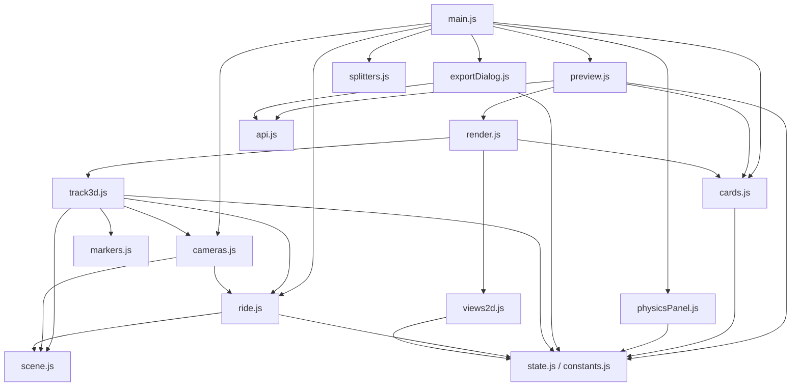
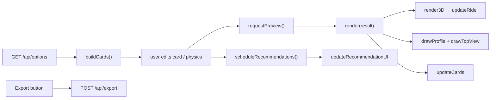

# `web/` — Browser front end (`index.html`, `style.css`, `js/`)

[← Back to index](../README.md)

**Served by:** [`server.py`](server.md) at `http://127.0.0.1:8000`
**Talks to:** `/api/options`, `/api/preview`, `/api/recommendations`, `/api/export`
**External library:** Three.js 0.170 (loaded from the jsDelivr CDN via an import map, so the page needs internet the first time)

## `index.html`
Page layout only — no logic. Loads `js/main.js` as an ES module.

| Area | Element ids |
|---|---|
| Header bar | `status`, `show-direction`, `show-normals`, `show-supports`, `fit-btn`, `export-btn` |
| Left sidebar | `sections` (section cards from `section-template`), friction / air toggles and inputs (`friction-btn`, `air-btn`, `mu-input`, `cd-input`, `area-input`, `mass-input`), `physics-summary` |
| 3D view | `view3d`, ride controls (`ride-btn`, `ride-reset`, `ride-speed`, `cam-mode`), HUD (`hud-speed`, `hud-section`, `hud-note`) |
| Bottom panel | `profile` (side view canvas), `topview` (top view canvas) |
| Export dialog | `export-dialog`, `export-form`, `export-result` |
| Resizable splitters | `split-left`, `split-bottom` |

## `style.css`
Layout (grid with resizable panels), section cards, pass/fail colours, physics panel, HUD and dialog styling.

## `js/` — JavaScript modules

Plain ES modules (`import` / `export`), no build step. The browser loads `main.js`, which imports the rest.

| File | Key exports | What it does |
|---|---|---|
| `main.js` | — | **Entry point.** Starts the animation loop, resize observer, header buttons, and the start-up sequence (`/api/options` → physics panel → cards → first preview) |
| `constants.js` | `SECTION_COLORS`, `DEFAULTS`, `STAT_LABELS`, marker colours, `RAIL_*`, `SPINE_*` | Shared constants |
| `state.js` | `state`, `currentTracks()`, `currentPhysics()`, `physicsKey()`, `lossesOn()`, `trackSlices()`, `hasReturnTrack()` | The page state object and helpers that read it |
| `api.js` | `api(path, body)`, `setStatus()` | `fetch` wrapper (throws with the server's `detail`); status text in the header |
| `preview.js` | `requestPreview()`, `scheduleRecommendations()`, `tracksChanged(section)` | `POST /api/preview` (one request at a time, always the latest) and debounced, cached `POST /api/recommendations` |
| `render.js` | `render(result)` | Draws a result everywhere: cards, 3D, side profile, top view |
| `cards.js` | `buildCards(onChange)`, `updateCards()`, `updateRecommendationUI()` | Section cards: dropdown, slider, safe-range band, stats, PASS/FAIL, warnings |
| `physicsPanel.js` | `setupPhysicsPanel(onChange)` | Friction and air-resistance toggles, inputs and summary line |
| `exportDialog.js` | `setupExportDialog()` | Export dialog → `POST /api/export`, asks before overwriting |
| `splitters.js` | `setupSplitters()` | Draggable / collapsible panels (sizes saved in `localStorage`) |
| `scene.js` | `renderer`, `scene`, `camera`, `controls`, `view3d`, `resize3D()` | Three.js setup and lights |
| `track3d.js` | `render3D(result)`, `fitCamera()` | Rails + spine from the up-vectors, support columns, normals, ground grid |
| `markers.js` | `addStartMarker()`, `addEndMarker()`, `addDirectionArrows()` | START platform, END label, direction cones (added to a given group) |
| `ride.js` | `ride`, `updateRide()`, `stepRide(dt)`, `poseAt()`, `CAR_LENGTH`, `CAR_HEIGHT` | The 4-car train, its speed along the track (`track.V`), HUD, Start/Reset buttons |
| `cameras.js` | `setCameraMode()`, `updateCamera(dt)`, `initFreeSpeed()` | Orbit, free-fly (WASD/QE/Space/Shift, drag, wheel) and on-ride cameras |
| `views2d.js` | `drawProfile()`, `drawTopView()` | Side profile and top view on `<canvas>`, coloured per section |

### How the modules depend on each other
There are no circular imports. Where a lower module needs to trigger something higher up (e.g. a card
change starting a new preview), `main.js` passes it a callback.

## Data flow in the page

## Adding something new
- A new control that should rebuild the track: call `requestPreview()` (and `scheduleRecommendations()` if it affects speeds).
- A new thing drawn in 3D: add a function that takes the `group` and call it from `render3D` in `track3d.js`.
- A new constant used by more than one file: put it in `constants.js`.
